# Captação de rio, caixa de 50 m³ sobre estrutura metálica e abastecimento não potável: estudo de engenharia

> **Natureza:** estudo de engenharia preliminar para um **caso fictício (exercício)**. Contém concepção, memoriais, simulações numéricas, testes, modelo 3D e desenhos. **Não vale para fabricação, construção ou operação.** O executivo exige levantamentos de campo, dados certificados de fornecedores, recálculo pelas edições vigentes das normas e ART de profissionais habilitados (CREA).

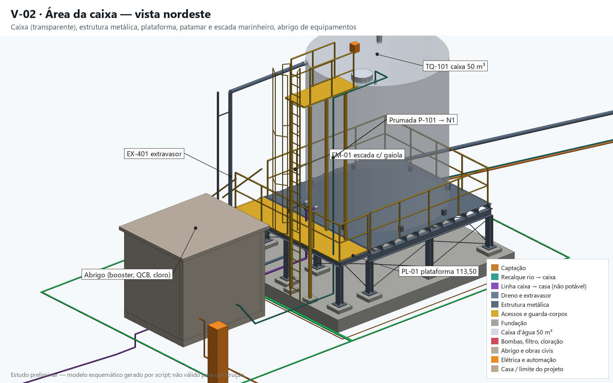

## Sumário

1. [Introdução ao problema](#1-introdução-ao-problema)
2. [Resultado em uma página](#2-resultado-em-uma-página)
3. [Dados de entrada e premissas](#3-dados-de-entrada-e-premissas)
4. [Condições de contorno](#4-condições-de-contorno)
5. [Solução adotada](#5-solução-adotada)
6. [Vistas 3D](#6-vistas-3d)
7. [Memorial de cálculo](#7-memorial-de-cálculo)
8. [Simulações numéricas (FEA e transiente)](#8-simulações-numéricas-fea-e-transiente)
9. [Testes de comprovação executados](#9-testes-de-comprovação-executados)
10. [Normas e exigências aplicadas](#10-normas-e-exigências-aplicadas)
11. [Lista de materiais (BOM)](#11-lista-de-materiais-bom)
12. [Desenhos](#12-desenhos)
13. [Riscos, limitações e pendências](#13-riscos-limitações-e-pendências)
14. [Estrutura do repositório e reprodução](#14-estrutura-do-repositório-e-reprodução)

---

## 1. Introdução ao problema

O proprietário de uma área rural no interior de São Paulo quer:

- **captar água de um rio** (ponto mais baixo do terreno);
- **armazená-la numa caixa de 50.000 L** numa área intermediária;
- **abastecer uma casa** situada **acima** da caixa.

A água serve **só para usos não potáveis**: descarga de vasos, lavagem de pisos e irrigação de jardim. A casa tem um sistema potável separado, fora do escopo.

O que torna o problema interessante:

| Desafio | Por que importa |
|---|---|
| A casa (piso 120,00; ponto mais alto 122,50) fica **acima** da caixa (base 113,50) | Gravidade nunca atende a casa: é preciso pressurizar, e o abastecimento depende de energia |
| O rio varia entre 97,50 e 102,00 e não há energia na margem | A captação deve funcionar em toda a faixa de níveis, sem quadro elétrico junto ao rio |
| Caixa de 50 m³ (~55 t cheia) a 1,50 m do solo, **sem sondagem** | Estrutura e fundação só podem ser pré-dimensionadas, com hipóteses explícitas |
| Caixa sem desenho certificado (bocais, apoio, ancoragem desconhecidos) | A estrutura deve atender o caso de apoio mais exigente e deixar pendências claras |
| Água bruta de rio, sem análise | O tratamento depende de análise e de normas de uso não potável |
| Área disponível de 8 × 8 m | É preciso verificar se cabem estrutura, equipamentos, acessos e manutenção |

A equipe simulada reúne estruturas metálicas e fundações, hidráulica e bombeamento, elétrica e automação, e modelagem 3D.

---

## 2. Resultado em uma página

| Pergunta do proprietário | Resposta | Evidência |
|---|---|---|
| Captar água do rio? | **Sim, preliminarmente.** Depende de batimetria (leito ≤ 95,70 m) | Bomba submersa sempre afogada; NPSHd = 10,1 m; Hman = 32,3 m no pior caso |
| Encher e manter os 50 m³? | **Sim** | 2,7 h/dia de bombeamento (limite 8 h); enchimento inicial em 16,7 h; ~5 dias de autonomia |
| Sustentar a caixa? | **Sim, no pré-dimensionamento**, com **ancoragem obrigatória** (a caixa vazia tomba com o vento) | Taxa máxima 0,81 no pórtico 3D (FEA-01); 16/16 testes aprovados |
| Água na casa com ≥ 15 m.c.a.? | **Sim, com o booster** (depende de energia) | 2,16 m³/h; setpoint 32,5 m.c.a.; estática ≤ 24,8 m.c.a. |
| Operar e manter com segurança? | **Sim** | Intertravamentos físicos, alarmes local e remoto, plataformas e zonas livres checadas no modelo 3D |
| Cabe nos 8 × 8 m? | **Parcialmente.** O conjunto completo pede **12,5 × 8 m** | Arranjo DES-04 e vista V-07 |
| Atende às normas? | Os critérios foram aplicados; **a conformidade formal fica para o executivo** | Várias normas têm edição nova (NBR 6123:2023, 8800:2024, 8681:2025, 5419:2026); licenças pendentes |

---

## 3. Dados de entrada e premissas

Origem de cada dado: **[C]** cliente · **[H]** hipótese do estudo · **[F]** fornecedor · **[L]** levantamento de campo · **[N]** norma ou literatura. A fonte única de todos os dados é [`calc/premissas.py`](calc/premissas.py).

### 3.1 Dados do cliente [C]

| Item | Valor |
|---|---|
| Níveis do rio: mínimo / normal / máximo | 97,50 / 100,00 / 102,00 m |
| Terreno: margem / área da caixa / piso da casa / ponto mais alto | 103,00 / 112,00 / 120,00 / 122,50 m |
| Distâncias horizontais | rio → área da caixa 80 m; área da caixa → casa 140 m |
| Caixa (fornecedor fictício) | 50 m³ úteis; Ø 4,00 × 4,50 m; 1.200 kg vazia; vertical, apoiada pela base, ao tempo |
| Base da caixa / área | 1,50 m acima do terreno; 8 × 8 m |
| Demanda diária | 8.000 L/dia (4.000 descarga/lavagem + 4.000 irrigação), repostos em ≤ 8 h de bombeamento |
| Demanda simultânea | 2 × 9 + 12 + 6 = **36 L/min**, com p ≥ 15 m.c.a. no ponto mais alto |
| Energia | 380 V, 3F, 60 Hz junto à caixa e à casa; nenhuma na margem |

### 3.2 Hipóteses principais [H] e sensibilidade

| Hipótese | Valor | Efeito se estiver errada |
|---|---|---|
| Perfil do terreno | interpolação linear entre as cotas; talude da margem 1V:1,5H | Pontos altos mudam perdas, transientes e ventosas |
| Leito do rio no ponto de captação | ≤ 95,70 m | Leito mais alto: poço escavado ou captação por infiltração |
| Diâmetro interno e níveis da caixa | Di = 3,96 m; fundo interno 113,55; bocais nas cotas do memorial | Volume útil e níveis de controle mudam |
| Comprimentos de tubo | 115 m (P-101) e 160 m (P-201) | ±0,5 m de perda a cada ±10 % de comprimento |
| Perdas de equipamentos | filtro 2 m (limpo) / 5 m (sujo); hidrômetro 1 m | Hman muda na mesma medida |
| Vento (formulação NBR 6123:1988) | V0 = 45 m/s, S1 = S3 = 1,0, categoria II, Ca = 0,8 | ±21 % na força com S1 = 1,1 ou V0 = 40 m/s |
| Solo | σadm = 100 kPa (só comparação); k_s = 10 / 20 / 40 MN/m³ (FEA) | Recalques e momentos do radier (ver FEA-03) |
| Rendimentos | bombas 0,50 / 0,40; motores 0,75–0,78; cosφ 0,80 | Correntes e potências |

Dados que dependem de fornecedor [F] e de levantamento [L]: ver [`ESTUDO_TECNICO.md` §2](ESTUDO_TECNICO.md).

---

## 4. Condições de contorno

| Disciplina | Condição | Valor / modelo |
|---|---|---|
| **Hidráulica: captação** | Nível de montante | Rio mínimo 97,50 (projeto), normal 100,00, máximo 102,00 |
| | Jusante | Descarga livre na caixa em 117,80 (separação atmosférica) |
| | Pressão atmosférica / vapor | 9,30 m.c.a. (altitude ≤ ~900 m) / 0,43 m.c.a. (30 °C) |
| | Rugosidade | ε = 0,05 mm (PEAD envelhecido) |
| **Hidráulica: casa** | Montante | Nível da caixa no LSLL 114,15 (pior caso) a 117,35 |
| | Jusante | Ponto 122,50 com p ≥ 15 m.c.a. → linha piezométrica requerida 137,50 m |
| **Transiente (SIM-04)** | Montante | Bomba com retenção: a vazão cai a zero numa rampa de 0,3 s (falta de energia) ou 5 s (soft-starter); sem refluxo |
| | Jusante | Carga constante 117,80 |
| | Fluido / tubo | a = 329 m/s (PE100 SDR 11, E ≈ 1,0 GPa); cavitação a −8,87 m.c.a. manométricos |
| **Estrutura (FEA-01)** | Apoios | 12 bases rotuladas (ux = uy = uz = 0) sobre os pedestais |
| | Ligações | Secundária ↔ principal por elo rígido; contraventamento Ø16 só-tração (diagonais comprimidas são retiradas por iteração) |
| | Cargas | Água até a borda (43,2 kPa na projeção Ø 4,00); caixa 11,8 kN; chapa e manta; peso próprio; vento 16,4 kN + binário 36,9 kN·m; plataforma 3 kPa |
| | Combinações | ELU 1,4G + 1,5Q + 1,4W + ψL; caixa vazia 1,0G + 1,4W; ELS G + Q + L |
| **Chapa (FEA-02)** | Apoios | w = 0 nas linhas das vigas secundárias (@ 0,44 m), rotações livres, bordas transversais livres |
| **Radier (FEA-03)** | Solo | Molas de Winkler k_s = 10 / 20 / 40 MN/m³ (hipótese, sem sondagem); bordas livres |
| | Cargas | Reações dos 12 apoios do FEA-01 (ELS e ELU-1) distribuídas nos pedestais de 0,5 × 0,5 m + peso próprio |
| **Elétrica** | Rede | 380 V 3F 60 Hz; capacidade, curto-circuito e aterramento do quadro existente **desconhecidos** |
| **Ambiental** | Uso de água | 8 m³/dia (limite de dispensa de outorga em SP: 25 m³/dia, Portaria DAEE 1.631/2017, a confirmar) |

---

## 5. Solução adotada

```
 RIO ── tubo-camisa DE200 + bomba submersa P-101 (3,0 m³/h; 33 m) ── CX-101 (válvulas, acima da cheia)
        │ cabo 4×4 mm² (130 m) desde o QCB-01: nenhuma energia na margem
        └─ PEAD DE40 SDR11 enterrado (115 m) ─ filtro autolimpante F-101 ─ hidrômetro FQ-101 ─ cloração CL-101
                                                         │
                         CAIXA 50 m³ (base 113,50) sobre estrutura metálica + radier
                         níveis: P-101 liga 116,80 / desliga 117,35; booster para em 114,15
                                                         │
          booster duplex P-201A/B (2,2 m³/h; 31 m; inversor, pressão constante 32,5 m.c.a.)
                                                         │
                  PEAD DE40 (160 m) identificado como NÃO POTÁVEL ── CE-01/VE-01 (limite do escopo) ── CASA
```

**Decisões e justificativas** (alternativas comparadas em [`ESTUDO_TECNICO.md` §3](ESTUDO_TECNICO.md)):

- **Bomba submersa em tubo-camisa inclinado no talude.**
  - Fica sempre afogada, sem escorva nem válvula de pé.
  - Retira-se pelo eixo da camisa.
  - Não precisa de energia na margem.
  - Foi rejeitada a bomba de superfície: NPSHd de ~2,4 m, marginal.
- **Booster na área da caixa.** A sucção fica afogada e a energia está no local. Gravidade é impossível, e um booster na casa teria sucção de 140 m, problemática.
- **Grelha de 3 × 3 pilares com deck de chapa contínua.**
  - O apoio plano integral atende o caso mais exigente.
  - Vãos de 2,20 m permitem perfis baixos, já que a base fica a só 1,50 m do terreno.
  - Tudo é parafusado e galvanizado a fogo.
- **Radier único.** Uniformiza os recalques sob o deck e tolera solo desconhecido. O pilar central recebe ~45 % da carga.
- **Separação dos sistemas.**
  - Identificação lilás e "ÁGUA NÃO POTÁVEL".
  - Torneiras de uso restrito.
  - Nenhuma conexão física com o sistema potável; reposição só por separação atmosférica.
  - Teste de isolamento no comissionamento.

---

## 6. Vistas 3D

As imagens são geradas por [`modelo3d/render_vistas.py`](modelo3d/render_vistas.py), um rasterizador próprio, a partir da mesma geometria paramétrica do modelo editável.

Arquivos do modelo:
- FreeCAD: [`.FCMacro`](modelo3d/saida/captacao_caixa_casa.FCMacro)
- [`.glb`](modelo3d/saida/captacao_caixa_casa.glb) e [`.obj`](modelo3d/saida/captacao_caixa_casa.obj)
- [visualizador web interativo](modelo3d/saida/visualizador_3d.html): baixe o arquivo e abra no navegador

| | |
|---|---|
| 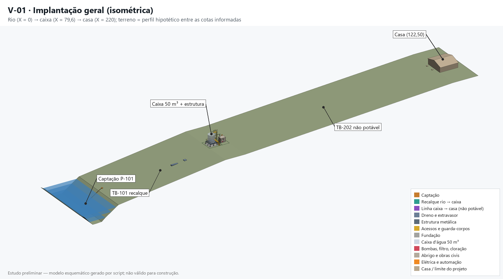 **V-01** Implantação geral |  **V-02** Área da caixa, nordeste |
| 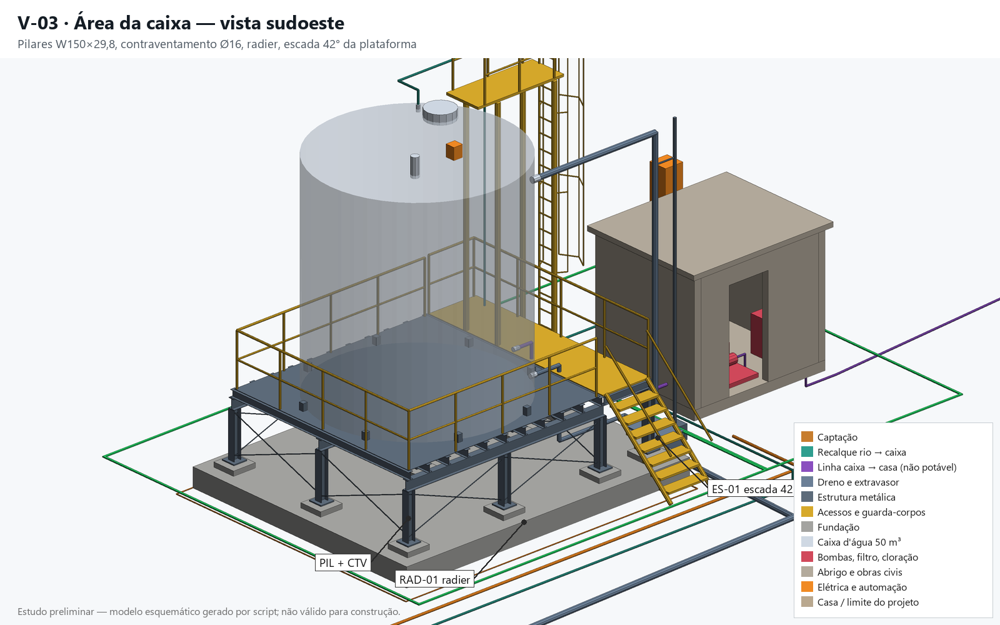 **V-03** Área da caixa, sudoeste | 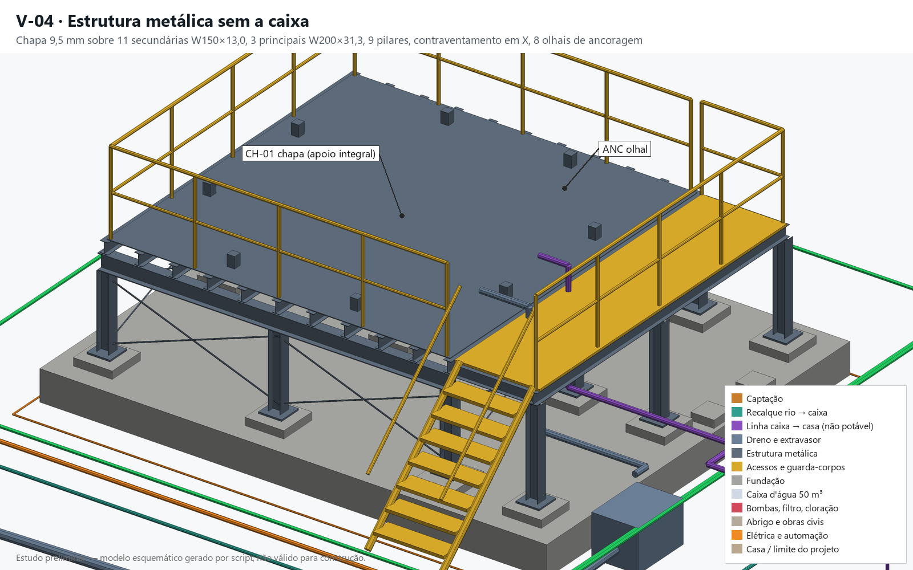 **V-04** Estrutura sem a caixa |
| 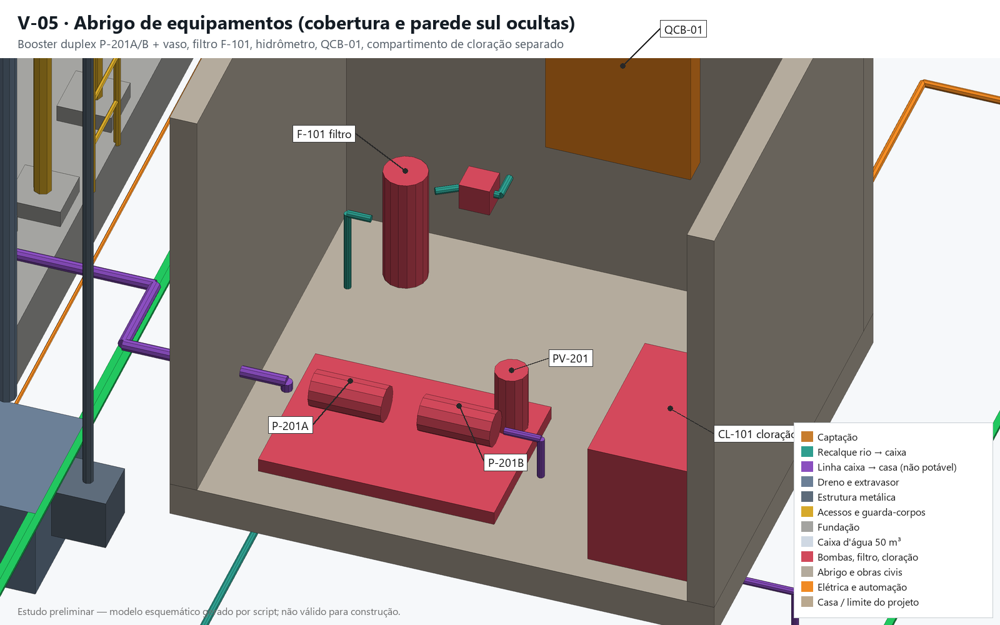 **V-05** Abrigo de equipamentos | 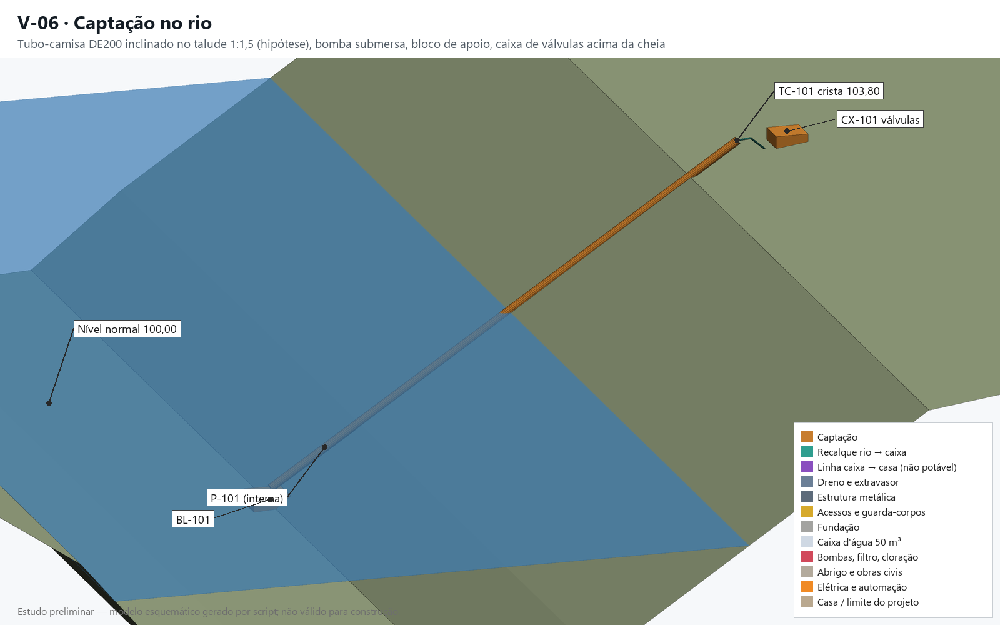 **V-06** Captação no rio |
| 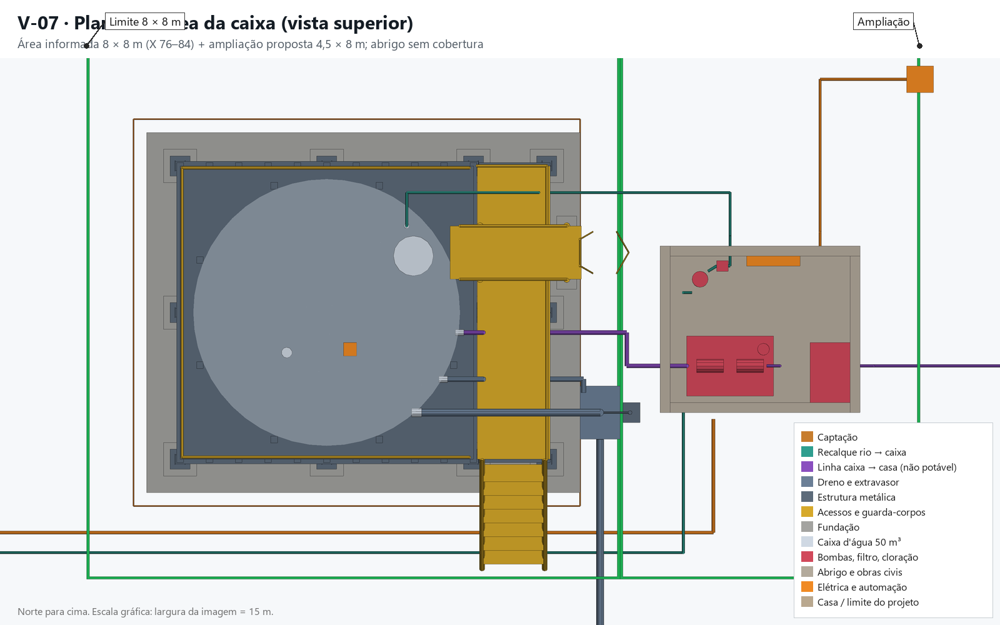 **V-07** Planta da área (8 × 8 + ampliação) | 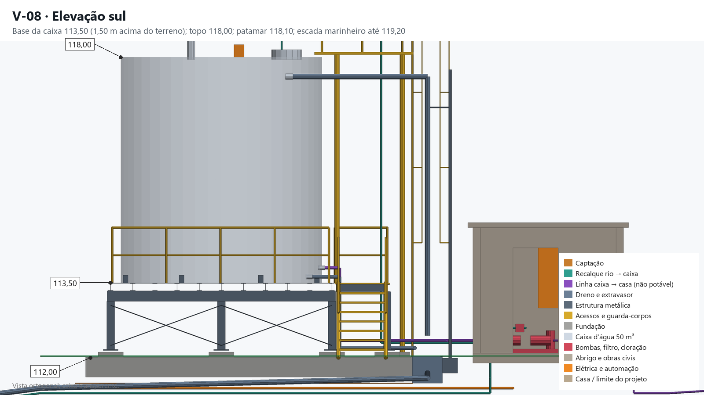 **V-08** Elevação sul |
| 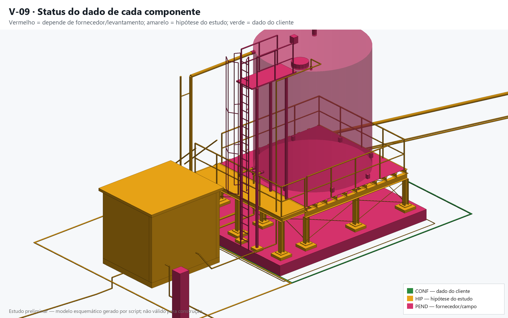 **V-09** Status do dado (cliente / hipótese / pendente) | 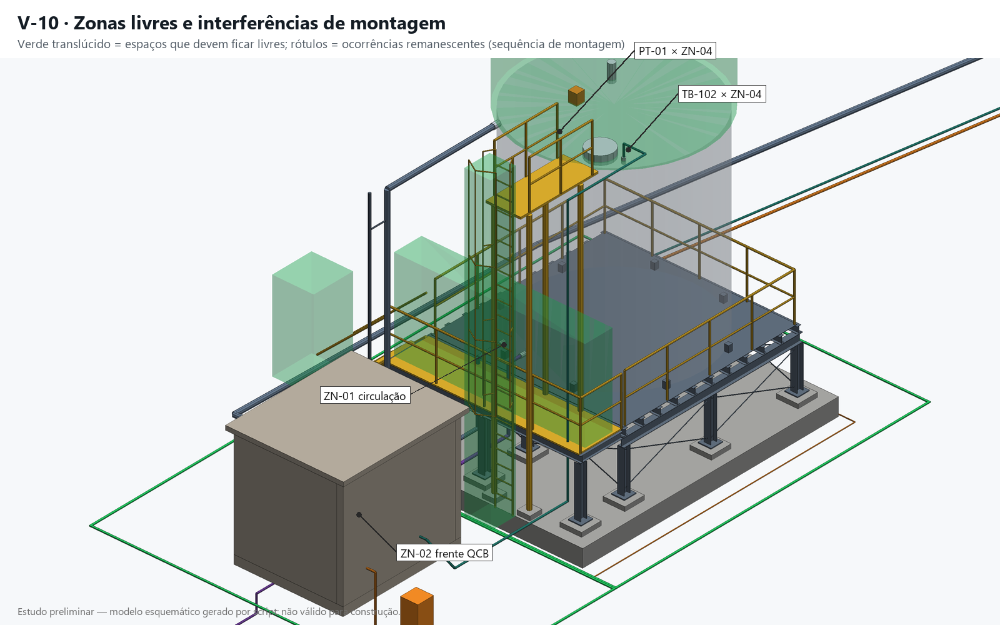 **V-10** Zonas livres e interferências |

**O modelo tem 73 componentes.** Cada um tem tag, descrição, status do dado (CONF / HIP / PEND) e pendência.

**A checagem automática de interferências** ([`interferencias.md`](modelo3d/saida/interferencias.md)) cobre:
- penetração > 3 mm entre sólidos;
- ocupação de 7 zonas livres: circulação, frente do painel, subida da escada, içamento da caixa, remoção das bombas, retirada da bomba do rio, pé da escada.

**Resultados da checagem:**
- A 1ª execução encontrou **8 conflitos reais de arranjo, todos corrigidos**. Por exemplo, o recalque do booster atravessava o compartimento de cloro.
- Restam 2 ocorrências de **sequência de montagem**: o patamar e a prumada sobre o teto devem ser montados depois do içamento da caixa.

---

## 7. Memorial de cálculo

Memoriais completos, com fórmula, substituição numérica e resultado em cada linha:
- [`MC-01_hidraulica.md`](calc/resultados/MC-01_hidraulica.md)
- [`MC-02_estrutura_fundacao.md`](calc/resultados/MC-02_estrutura_fundacao.md)
- [`MC-03_eletrica.md`](calc/resultados/MC-03_eletrica.md)

Todos são gerados por `python calc/run_all.py`.

### 7.1 Hidráulica

| Grandeza | Fórmula | Resultado |
|---|---|---|
| Vazão mínima de reposição | Q = 8 m³ / 8 h | 1,0 m³/h → **adotado 3,0 m³/h** (fator 3: retrolavagem, desgaste, enchimento) |
| Bombeamento diário | t = 8 / 3,0 | **2,67 h/dia** ≤ 8 h ✓ |
| Velocidade no recalque (DE40 SDR11, Di = 32,6 mm) | v = Q/A | 1,00 m/s |
| Fator de atrito | Swamee-Jain (conferido com Colebrook: T10) | f = 0,0271 |
| Perda distribuída (115 m) | hf = f·L/D·v²/2g | 4,85 m |
| **Hman de P-101** | Hest (20,30) + 1,1·(hf + hl) + filtro sujo 5 m + hidrômetro 1 m | **32,3 m** (rio mínimo); 26,8 m (normal); 24,8 m (cheia) |
| NPSHd de P-101 | Patm + submergência − pv | 9,30 + 1,20 − 0,43 = **10,1 m** |
| Linha piezométrica requerida na casa | 122,50 + 15 | 137,50 m |
| **Hman do booster** | 137,50 − 114,15 + perdas (sucção 0,05; recalque 3,94·1,1; hidrômetro 0,5; rede interna 2,5) | **30,7 m** @ 2,16 m³/h |
| Setpoint do inversor | LP requerida + perdas a jusante − cota da bomba | **32,5 m.c.a.** |
| Pressão estática máxima na casa | 144,8 − 120,00 | 24,8 m.c.a. ≤ 40 ✓ |
| Submergência anti-vórtice | S = D(1 + 2,3Fr) (ANSI/HI 9.8) | 0,10 m exigido; 0,35 m disponível ✓ |
| Golpe de Joukowsky | ΔH = a·v/g | 33,4 m (P-101); 24,1 m (P-201). Ver SIM-04 |
| Volume operacional / autonomia | (117,35 − 114,15)·A | 39,4 m³ / 4,9 dias |

### 7.2 Estrutura e fundação (NBR 8800 / NBR 6118)

| Elemento | Verificação | Solicitante | Resistente | Taxa |
|---|---|---|---|---:|
| Chapa 9,5 mm, vão 0,44 m | flexão e flecha | 1,63 kN·m/m; 1,53 mm | 5,13 kN·m/m; L/250 = 1,76 mm | 0,87 |
| Secundária W150×13,0 | FLT/FLM/FLA, V, flecha | 18,0 kN·m; 41,9 kN | 27,7 kN·m; 120 kN | 0,65 |
| Principal W200×31,3 | idem | 95,3 kN·m; 200 kN | 103,7 kN·m; 253 kN | 0,92 |
| Pilar W150×29,8 (K = 1, e = 5 cm) | N + M | 476 kN | 1.126 kN | 0,70 |
| Diagonal Ø16 | tração na rosca | 7,7 kN | 44,7 kN | 0,17 |
| Placa de base 300×300×22,4 | flexão e contato | t mín 19,2 mm; 5,3 MPa | 22,4 mm; 15,3 MPa | 0,86 |
| Chumbadores 4 × M20 F1554 | V, T | 7,1 / 3,0 kN | 149 / 69,8 kN | < 0,1 |
| **Caixa vazia sem ancoragem** | tombamento | 36,9 kN·m | 23,5 kN·m | **FS 0,64: ancoragem obrigatória** (8 × Td ≈ 5 kN) |
| Radier 6,50 × 5,40 × 0,40, C30 | pressão no solo | 27,6 / 29,6 kPa | σadm hip. 100 kPa | 0,30 |
| Radier | punção no pilar central | τSd 0,18 MPa | τRd1 0,41 MPa | 0,45 |

**Ações consideradas:**
- água até a borda: 542 kN, com γ = 1,5 (sem o benefício de "ação truncada");
- vento: V0 = 45 m/s, q = 1,14 kPa, F = 16,4 kN na caixa.

**Massa de aço:** ~4,1 t.

### 7.3 Elétrica

| Item | Resultado |
|---|---|
| Demanda máxima | 4,4 kVA (6,7 A trifásico) |
| P-101 | 1,1 kW (hip.), cabo submersível 4 × 4 mm², 130 m: ΔV 0,69 % em regime, 1,3 % com soft-starter |
| P-201A/B | 0,75 kW cada, inversor, alternância |
| Alimentador | 4 × 4 mm² + PE (~30 m, hipótese), disjuntor 16 A, DPS classe II |
| Proteções | Disjuntores-motor, relés de fase e subcarga (seco), DR 30 mA, emergência (NR-12), bloqueio (NR-10) |
| Aterramento | Eletrodo de fundação no radier, equipotencialização; SPDA conforme análise de risco NBR 5419-2:2026 |

---

## 8. Simulações numéricas (FEA e transiente)

Ferramenta própria em Python/numpy ([`fea/elementos.py`](fea/elementos.py)):
- pórtico espacial de Euler-Bernoulli (12 GL);
- treliça só-tração;
- placa de Mindlin-Reissner Q4 com integração seletiva;
- método das características com cavidade discreta de vapor (DVCM).

Os elementos foram validados contra soluções analíticas (seção 9). Resultados completos em [`fea/resultados/FEA.md`](fea/resultados/FEA.md).

### FEA-01: Pórtico espacial completo e análise modal

O modelo tem 284 nós e 325 elementos: 11 secundárias discretizadas a cada 0,22 m, 3 principais, 9 pilares, plataforma, 20 diagonais só-tração. São 6 combinações.

| Resultado | Valor |
|---|---|
| Equilíbrio (Σ reações − Σ cargas) | < 5·10⁻⁹ kN em todas as combinações |
| Taxa de utilização máxima | **0,81** (viga principal W200×31,3); secundária 0,64; pilar 0,49; diagonal 0,10 |
| Flechas ELS | 3,06 mm (secundárias); 1,83 mm (principais), contra limite de 6,29 mm |
| Pilar central (água) | 258 kN, contra 298 kN no modelo 1D (que supõe apoios rígidos e é conservador) |
| Modos de vibração | **2,62 Hz** (lateral Y), 4,01 Hz (X), 5,31 Hz: acima de 1 Hz, sem efeito dinâmico relevante de vento |
| Sloshing da água (modo convectivo) | 0,48 Hz: desacoplado, relevante apenas para análise sísmica |

| Deformada (ELS, ×150) | Utilização (ELU) |
|---|---|
| 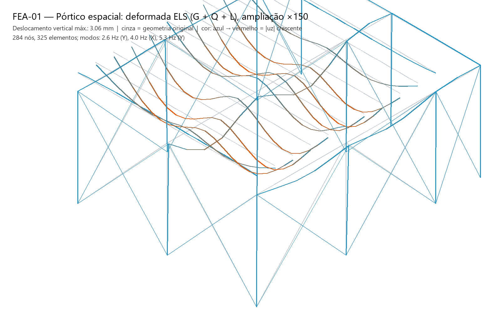 | 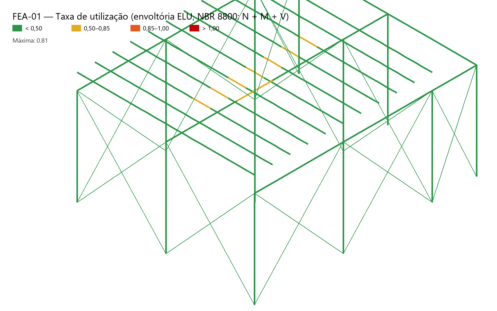 |

### FEA-02: Chapa de piso de 9,5 mm (placa de Mindlin)

A placa é contínua sobre 5 linhas de vigas (@ 0,44 m) e tem 800 elementos.

| Condição | Resultado | Limite |
|---|---|---|
| Flecha, ELS (q = 44,9 kPa) | **0,78 mm** | 1,76 mm (L/250) |
| Tensão, ELU (q = 67,2 kPa) | σ = 74 MPa (M− = 1,12 kN·m/m) | fy/γa1 = 227 MPa |

A verificação manual, que supunha a chapa biapoiada (1,53 mm), era conservadora.

| Flecha (ELS) | Momento Mx (ELU) |
|---|---|
| 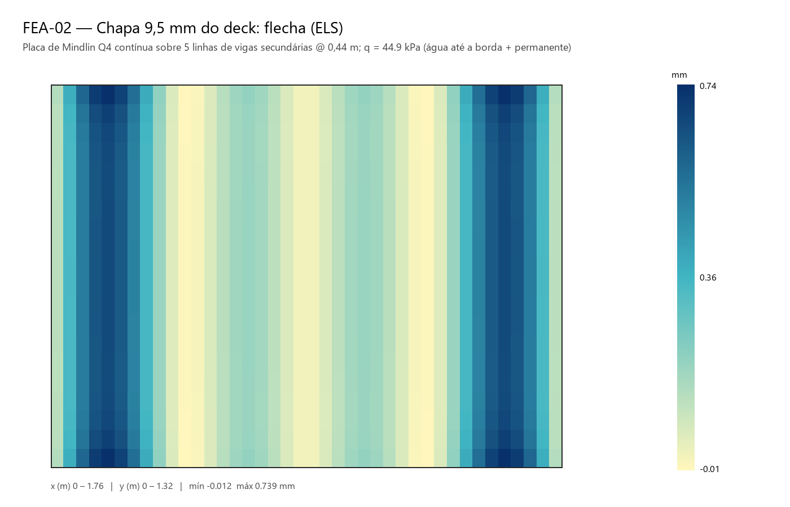 | 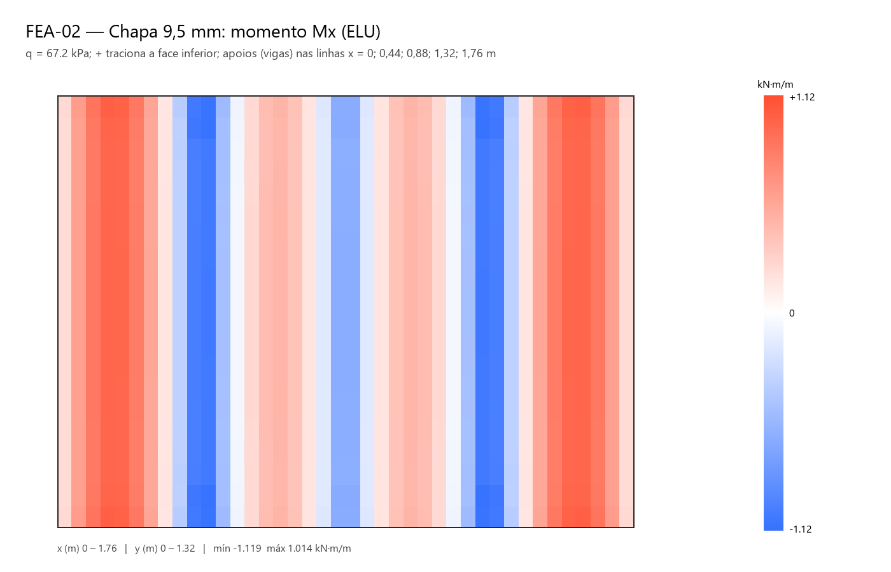 |

### FEA-03: Radier sobre base elástica de Winkler

A placa espessa de Mindlin tem 0,40 m e Ecs = 26,8 GPa, com malha alinhada aos pedestais. As cargas vêm do FEA-01.

| k_s (MN/m³, hip.) | Recalque máx. | Distorção angular | Pressão no solo | m* máx. sob o pilar central | Taxa da malha mínima |
|---:|---:|---:|---:|---:|---:|
| 10 | 3,3 mm | 1/2.741 | 15–33 kPa | 86 kN·m/m | 1,00 |
| 20 | 1,7 mm | 1/4.332 | 12–35 kPa | 80 kN·m/m | 0,93 |
| 40 | 1,0 mm | 1/6.510 | 8–40 kPa | 73 kN·m/m | 0,85 |

**Achado da FEA:** a estimativa simplificada (reação uniforme) **subestimava o momento local** sob o pilar central. Foi adotado reforço inferior **Ø12,5 c/12,5 numa região de 2,40 × 2,40 m** (MRd ≈ 210 kN·m/m).

A modelagem também mostrou que os pedestais do patamar caíam parcialmente fora do radier. **O radier passou de 6,30 para 6,50 m.**

Os recalques são pequenos em todos os cenários. **A colapsibilidade do solo, porém, não é representada por Winkler** e exige sondagem e ensaio.

| Recalque, ELS (k = 20) | Momento Mx, ELU (k = 20) |
|---|---|
| 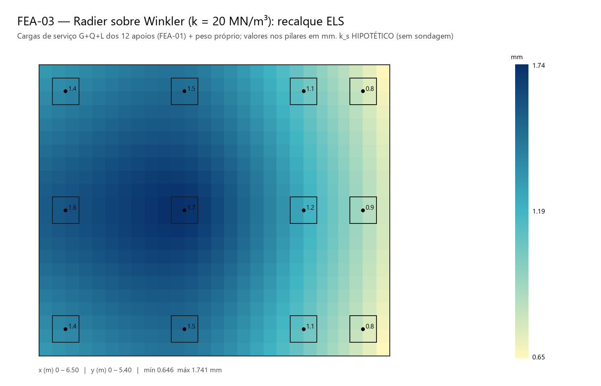 | 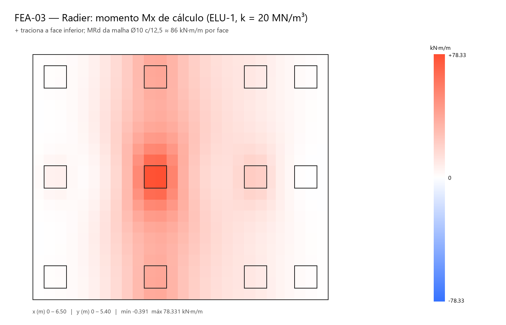 |

### SIM-04: Golpe de aríete no recalque da captação (MOC + DVCM)

O perfil do tubo é hipotético: camisa no talude, vala, abrigo e prumada. São 46 trechos, com Δt = 0,0076 s.

| Cenário | Pressão máx. | Pressão mín. | Separação de coluna |
|---|---:|---:|---|
| A: falta de energia (rampa de 0,3 s) | **118,7 m.c.a.** | −8,9 (vapor) | **Sim**, no trecho do talude |
| B: parada pelo soft-starter (rampa de 5 s) | 26,4 m.c.a. | −0,5 | Não |

**Conclusões:**
- A parada suave elimina o problema nas paradas normais.
- Na falta de energia, o colapso da cavidade gera pico bem acima da estimativa de Joukowsky (~76 m). O pico continua abaixo do PN16 (160 m), o que **confirma o SDR 11 PN 16**.
- No executivo: repetir com o perfil topográfico real em software comercial de transientes e avaliar válvula de admissão e expulsão de ar na crista.

| Envoltórias ao longo do tubo | Pressão × tempo |
|---|---|
| 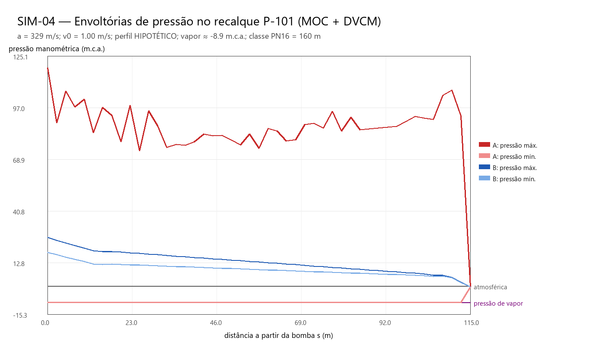 | 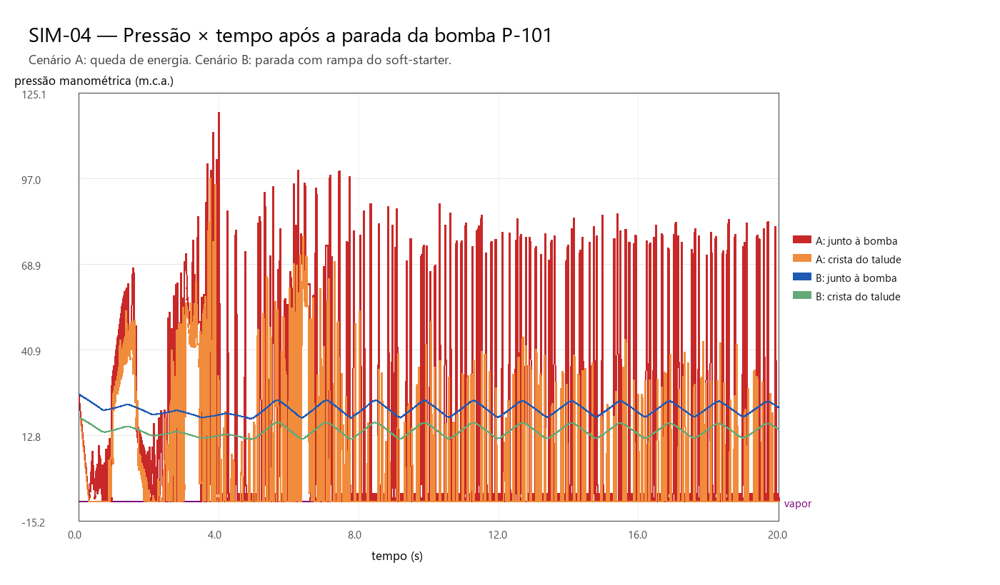 |

---

## 9. Testes de comprovação executados

[`testes/run_testes.py`](testes/run_testes.py) gera o relatório [`testes/RELATORIO_TESTES.md`](testes/RELATORIO_TESTES.md). **Resultado: 16/16 aprovados.**

| Código | Teste | Referência | Resultado |
|---|---|---|---|
| T01 | Viga contínua 2 vãos (FE 1D) | R = 1,25qL; M = qL²/8 | erro < 0,01 % ✅ |
| T02 | Pórtico 3D: balanço com cargas em 3 direções | PL³/3EI (forte e fraco); NL/EA | erro < 0,1 % ✅ |
| T03 | Pórtico do projeto: equilíbrio global (6 combinações) | Σ reações = Σ cargas | erro 4·10⁻⁹ kN ✅ |
| T04 | Pórtico 3D × modelo 1D | ΣQ = peso da água; pilar central | ΣQ < 0,1 %; pilar −14 % (1D conservador) ✅ |
| T05 | Placa de Mindlin simplesmente apoiada | Timoshenko: w = 0,00406qa⁴/D; Mx = 0,0479qa² | erro 0,9 % / 0,3 % ✅ |
| T06 | Placa de Mindlin engastada | Timoshenko: w = 0,00126qa⁴/D | erro 0,3 % ✅ |
| T07 | Placa sobre Winkler, carga uniforme | w = q/k, M = 0 | exato ✅ |
| T08 | MOC: parada instantânea | Joukowsky ΔH = a·v/g | erro < 0,1 % ✅ |
| T09 | MOC: regime permanente | sem variação | 3·10⁻⁸ m ✅ |
| T10 | Atrito Swamee-Jain × Colebrook iterativo | Colebrook-White | erro < 1,5 % ✅ |
| T11 | Funções NBR 8800 nos limites teóricos | Zx·fy/γa1; A·fy/γa1 | erro < 0,01 % ✅ |
| T12 | Integridade do glTF 2.0 | especificação Khronos | ✅ |
| T13 | 7 desenhos SVG bem formados | XML | 7/7 ✅ |
| T14 | Interferências remanescentes tratadas | nenhuma "A RESOLVER" | 2 de montagem, tratadas ✅ |
| T15 | Reprodutibilidade dos memoriais | hash SHA-256 idêntico | ✅ |
| T16 | Hman de P-101 recalculada de forma independente | balanço de energia | erro < 0,1 % ✅ |

Os testes verificam o **software** e a **consistência**. Não substituem revisão independente por engenheiro habilitado nem validação com dados reais.

---

## 10. Normas e exigências aplicadas

A vigência foi verificada em 26/11/2026 (catálogo ABNT/Target, iso.org, astm.org, portais oficiais). **O texto integral não foi consultado.** Onde o critério aplicado vem de edição anterior, isso está indicado.

| Norma / documento | Edição vigente | Aplicação |
|---|---|---|
| ABNT NBR 5626 (água fria e quente) | 2020 | Pressões na casa, separação atmosférica, limite com a instalação interna |
| ABNT NBR 16783 (fontes alternativas não potáveis) | 2019 | Uso não potável, identificação, qualidade (valores-limite **não verificados**) |
| ABNT NBR 12213 / 12214 / 12215-1 (captação, bombeamento, adutora) | 1992 / 2020 / 2017 | Captação, reserva de bombas, transientes, ventosas |
| ABNT NBR 15561 (tubos PE 80/PE 100) | 2024 | PEAD PE100 SDR 11 PN 16 |
| ABNT NBR 8800 (estruturas de aço) | **2024** | Verificações (formulação 2008 aplicada: **revisar**) |
| ABNT NBR 8681 (ações e segurança) | **2025** | Combinações (coeficientes da NBR 8800:2008: **revisar**) |
| ABNT NBR 6123 (vento) | **2023** (errata 2025) | Vento (formulação 1988: **refazer**) |
| ABNT NBR 15421 (sismo) | 2023 | Zona sísmica a confirmar |
| ABNT NBR 6118 (concreto) / NBR 6122 (fundações) | 2023 (emenda 2026) / 2019 | Radier, punção, armadura mínima / investigação |
| ABNT NBR 6484 / NBR 8036 (sondagens) | 2020 / 1983 | Programa de sondagem |
| ABNT NBR 15980 (perfis laminados) | 2024 | Dimensões dos perfis W |
| ABNT NBR 6323 / ISO 1461 (galvanização) | 2025 / 2022 | Proteção anticorrosiva |
| ABNT NBR ISO 14122-1 a 4 (acessos permanentes) | 2023 | Plataforma, escadas, guarda-corpos, escada marinheiro |
| ABNT NBR 5410 (BT) / NBR 5419-1 a 4 (SPDA) | 2004 / **2026** | Proteções, DR, queda de tensão / análise de risco |
| ABNT NBR IEC 60529 / 61439-1 / NBR 17094-1 | 2017 / 2016 / 2018 | IP, painel, motores |
| ANSI/HI 9.8 (tomadas de bombas) | 2024 | Submergência anti-vórtice |
| ISO 9906 / ISO 9223 / ISO 12944 | 2012 / 2012 / 2017–2019 | Ensaio de bombas / corrosividade / pintura |
| ASTM A572-25, A36-19, F1554-20, F3125-26, A123-24 | — | Materiais |
| Lei 9.433/1997; LC SP 1.413/2024 (SP Águas); Portaria DAEE 1.631/2017 | — | Outorga ou dispensa (≤ 25 m³/dia, cadastro obrigatório) |
| Lei 12.651/2012, art. 3º X "b", 4º e 8º; CONAMA 369/2006; CETESB | — | Intervenção de baixo impacto em APP |
| CONAMA 357/2005 e 430/2011 | — | Classe do rio; descarte |
| NR-10, NR-12, NR-33, NR-35 | NR-10 nova a partir de 06/2027 | Segurança em eletricidade, máquinas, espaço confinado, altura |
| Lei 6.496/1977; CONFEA Res. 1.137/2023 (alt. 1.160/2025) | — | ART |

Tabela completa, com títulos e aplicação: [`ESTUDO_TECNICO.md` §12](ESTUDO_TECNICO.md).

---

## 11. Lista de materiais (BOM)

| # | Item | Qtd. | Especificação para consulta | Situação |
|---|---|---:|---|---|
| 1 | Bomba submersa 4" P-101 + motor | 1 + 1 reserva | Q 3,0 m³/h @ H ≥ 33 m (faixa 25–33 m); 3F 380 V, 0,75–1,1 kW, não sobrecarregável; inox; retenção; instalação inclinada ~34°; curva ISO 9906 | PEND curva |
| 2 | Pressurizador duplex P-201A/B | 1 conjunto | 2 × Q 2,2 m³/h @ H ≥ 31 m; NPSHd 10,7 m; inversor por bomba; transmissor; vaso 8–24 L | PEND curva |
| 3 | Filtro autolimpante F-101 | 1 | 3 m³/h; malha ~130 µm (conforme análise); retrolavagem por ΔP | PEND |
| 4 | Hidrômetro FQ-101 com pulso | 1 | DN 25–32; perda ≤ 1 m | PEND |
| 5 | Cloração (dosadora + tanque 100 L) | 1 | Proporcional, intertravada com P-101 | PEND análise |
| 6 | Nível LT-101 + boias LSHH/LSLL + eletrodo LSL-100 | 1 + 3 | 4–20 mA; contato seco | HIP |
| 7 | Caixa d'água 50 m³ | 1 | Dados certificados (bocais, apoio, **ancoragem**, teto) | **PEND** |
| 8 | Tubo PEAD PE100 SDR 11 PN 16 DE 40 | ~300 m | NBR 15561; identificação lilás na linha da casa | HIP |
| 9 | PEAD DE 63 / DE 75 / DE 200 perfurado | 10 / 6 / 14 m | Sucção / dreno / camisa | HIP |
| 10 | Tubo DN 100 (extravasor + descarte) | ~40 m | PVC reforçado ou PEAD | HIP |
| 11 | Válvulas e acessórios | ~20 | Esferas PN 16, retenções de mola, filtro Y, juntas flexíveis, manômetros, ventosas conforme topografia | HIP |
| 12 | Perfis W150×13,0 (11 × 4,4 m + plataforma), W200×31,3 (3 × 4,4 m), W150×29,8 (9 × ~1,0 m), W150×22,5 (3 postes) | ~1,4 t | ASTM A572 Gr50, galvanizado a fogo | HIP |
| 13 | Chapa 9,5 mm (19,4 m²); placas de base 300×300×22,4 (12); Ø16 com esticador (16) | ~1,7 t | ASTM A36, galvanizado | HIP |
| 14 | Grade de piso, guarda-corpos, escada 42°, escada marinheiro com gaiola e patamar | verba | NBR ISO 14122 | HIP / PEND (acesso ao teto) |
| 15 | Parafusos e chumbadores | — | M16/M12 F3125 A325 galv.; 48 M20 F1554 Gr36 galv.; 8 olhais de ancoragem | HIP / PEND |
| 16 | Concreto C30 / lastro / CA-50 | 14,4 m³ / 1,8 m³ / ~0,85 t | Radier 6,50 × 5,40 × 0,40 + pedestais; reforço sob o pilar central | **PEND sondagem** |
| 17 | Abrigo de equipamentos | 3,0 × 2,5 m | Ventilado, compartimento de cloro separado | HIP |
| 18 | QCB-01 | 1 | IP65; seccionadora com bloqueio; DPS; soft-starter; 2 inversores; relés; DR; CLP; GSM | HIP |
| 19 | Cabos e eletrodutos | — | Submersível 4 × 4 mm² (130 m); alimentador 4 × 4 mm² + PE; PEAD corrugado Ø 50 | HIP |
| 20 | Aterramento + entrada para gerador (opcional) | 1 + 1 | Eletrodo de fundação, BEP; chave reversora intertravada ~5 kVA | HIP / decisão |
| 21 | Caixas CX-101, CP-301, CD-301, CE-01; vala de infiltração; enrocamento e geotêxtil | — | — | HIP / PEND |

**Massa total de aço estimada:** ~4,1 t (MC-02 §8).

---

## 12. Desenhos

| Folha | Conteúdo |
|---|---|
| [DES-01](desenhos/svg/DES-01_implantacao_geral.svg) | Implantação geral, coordenadas, APP indicativa |
| [DES-02](desenhos/svg/DES-02_perfil_hidraulico.svg) | Perfil longitudinal e linhas piezométricas |
| [DES-03](desenhos/svg/DES-03_estrutura_fundacao.svg) | Estrutura metálica, elevação, base de pilar, radier |
| [DES-04](desenhos/svg/DES-04_arranjo_area_caixa.svg) | Arranjo da área da caixa, zonas livres, ampliação |
| [DES-05](desenhos/svg/DES-05_fluxograma_PID.svg) | Fluxograma P&ID, níveis e lógica |
| [DES-06](desenhos/svg/DES-06_unifilar.svg) | Diagrama unifilar |
| [DES-07](desenhos/svg/DES-07_captacao_corte.svg) | Corte da captação |

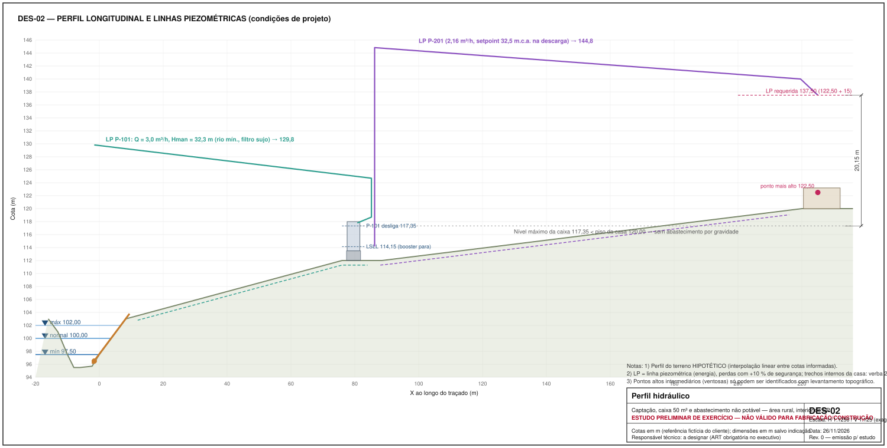

---

## 13. Riscos, limitações e pendências

**Riscos técnicos identificados:**
- dependência de energia para abastecer a casa;
- caixa vazia instável sem ancoragem;
- separação de coluna no recalque em queda de energia;
- solos colapsíveis, frequentes no interior de SP;
- leito do rio raso;
- turbidez sazonal;
- capacidade elétrica existente desconhecida.

**Limitações do estudo:**
- caso fictício, sem topografia, sondagem, batimetria nem análise de água;
- caixa sem desenho certificado;
- formulações de normas de edições anteriores (NBR 6123, 8800, 8681);
- k_s do radier hipotético;
- perfil do transiente hipotético;
- macro do FreeCAD não executada (só a sintaxe foi validada).

**Antes do executivo:**
1. Topografia, batimetria, sondagem SPT com ensaio de colapsibilidade, análise da água nas duas estações.
2. Dados certificados da caixa e propostas de bombas, filtro e dosadora.
3. Regularização: cadastro e dispensa ou outorga (SP Águas), autorização em APP (CETESB), destino do descarte.
4. Projeto executivo com ART:
   - recálculo pelas normas vigentes;
   - transiente com o perfil real;
   - fundação conforme a sondagem;
   - desenhos de fabricação;
   - plano de içamento;
   - comissionamento com teste de isolamento entre os sistemas.

---

## 14. Estrutura do repositório e reprodução

```
ESTUDO_TECNICO.md / estudo_tecnico.html   relatório técnico completo (seções 0–16)
calc/        premissas.py (FONTE ÚNICA) · hidraulica.py · estrutura.py · eletrica.py · run_all.py
             resultados/MC-01..03 (memoriais) · resultados.json
fea/         elementos.py · portico3d.py · placas.py · transiente_moc.py · graficos.py · run_fea.py
             resultados/FEA.md + PNG + JSON
testes/      run_testes.py · RELATORIO_TESTES.md
modelo3d/    componentes.py (73 componentes) · gerar_modelo.py · render_vistas.py · visualizador_template.html
             saida/ .FCMacro · .glb · .obj/.mtl · visualizador_3d.html · interferencias.md
             vistas/ V01–V10 (PNG)
desenhos/    gerar_desenhos.py · svg/DES-01..07
artifact/    versão do relatório para publicação web
```

**Requisitos:** Python ≥ 3.10, numpy e Pillow. Para reproduzir tudo, rode na raiz do repositório:

```bash
python calc/run_all.py            # memoriais de cálculo
python modelo3d/gerar_modelo.py   # modelo 3D + interferências
python modelo3d/render_vistas.py  # vistas PNG (~1,5 min)
python fea/run_fea.py             # FEA + transiente
python desenhos/gerar_desenhos.py # desenhos SVG
python testes/run_testes.py       # testes de comprovação
python gerar_relatorio_html.py    # relatório HTML
```

**Para mudar uma hipótese:** edite [`calc/premissas.py`](calc/premissas.py) e rode a sequência de novo. Cálculos, modelo, vistas, FEA, desenhos e testes são todos regenerados. Os números citados no texto do README e do relatório precisam de revisão manual.

**Modelo editável:** no FreeCAD 0.21 ou 1.0, use Macro → Executar → `modelo3d/saida/captacao_caixa_casa.FCMacro`. Ela gera e salva o `.FCStd`. Alternativas: importar o `.glb` ou o `.obj` no FreeCAD ou no Blender.

**Convenções:**
- coordenadas reais: X ao longo do traçado (X = 0 na borda d'água do nível mínimo), Y para o norte, Z = cota;
- OBJ, GLB e HTML: Y para cima, origem no centro da caixa na cota 112,00.

---

*Estudo de exercício elaborado com apoio de IA (Claude). Todos os cálculos são reproduzíveis por script; as limitações estão declaradas. Responsabilidade técnica: a designar, com ART obrigatória antes de qualquer fabricação ou obra.*
