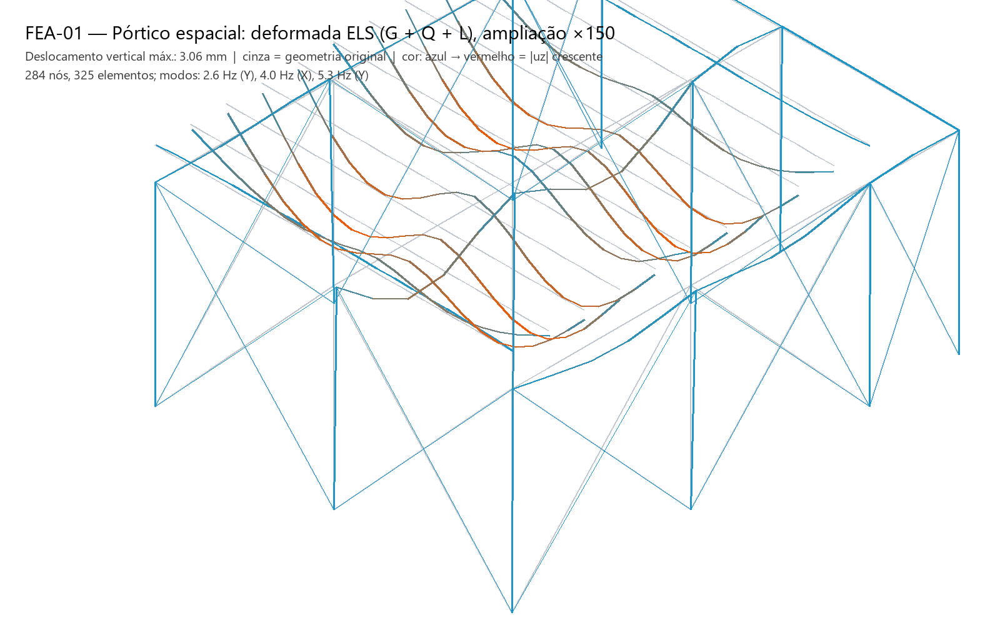
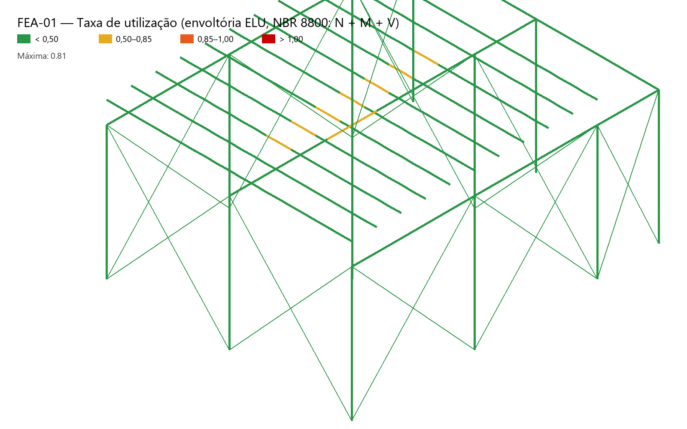
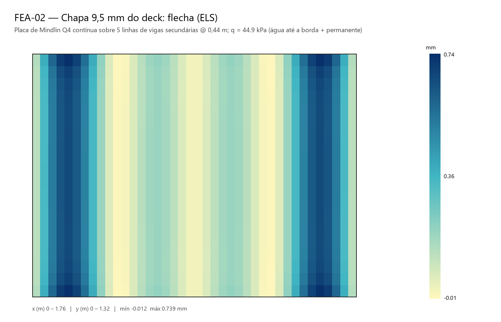
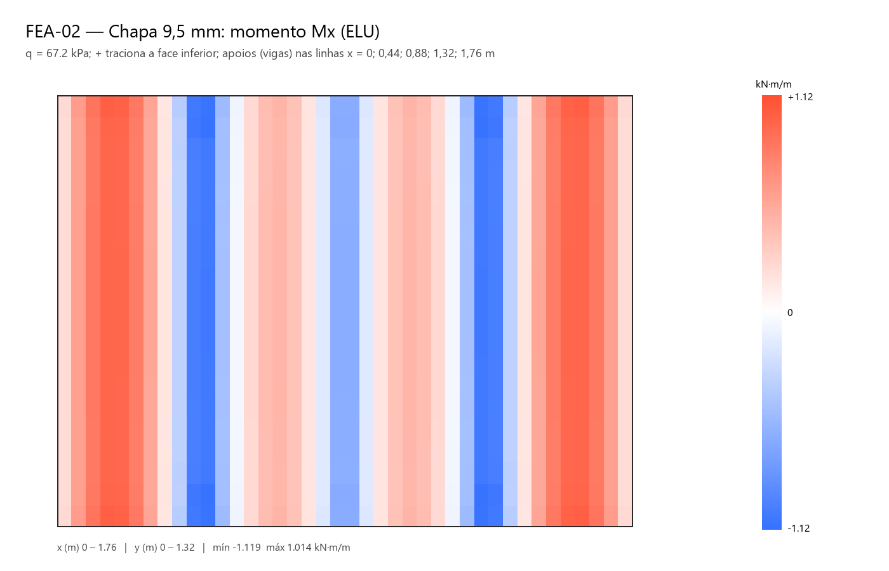
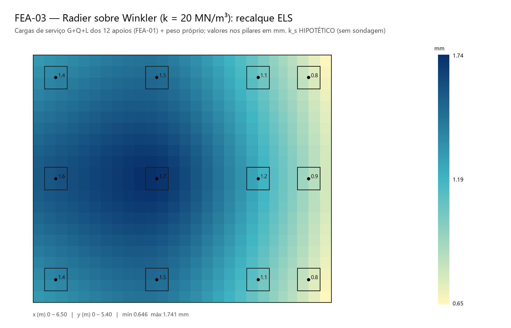
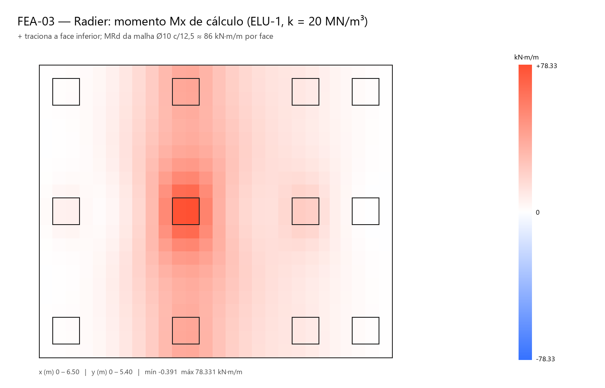
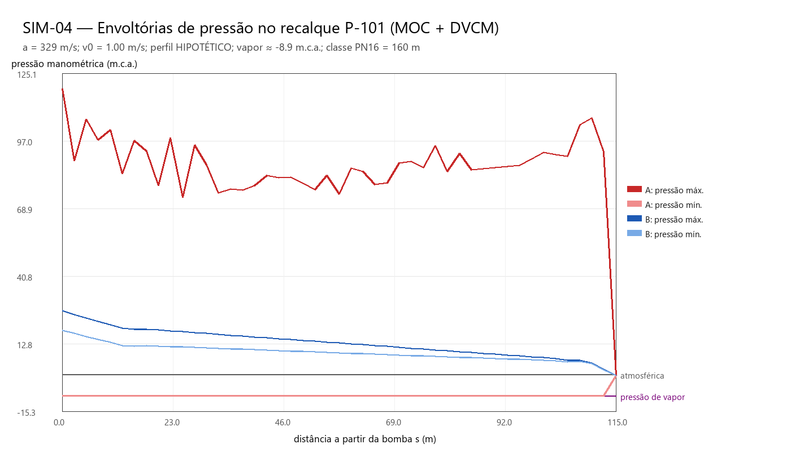
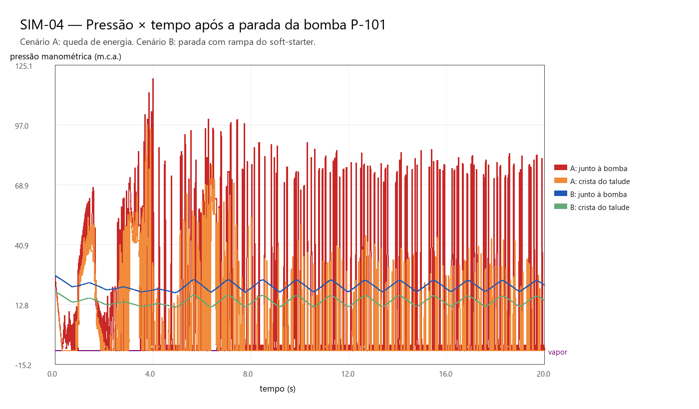

# Resultados das simulações numéricas (FEA e transiente)

Gerado por `fea/run_fea.py`. Ferramenta própria em Python/numpy (elementos em `fea/elementos.py`), validada pelos testes de `testes/run_testes.py`.

## FEA-01 — Pórtico espacial da estrutura

Modelo: 284 nós, 325 elementos (secundárias discretizadas a cada 0,22 m; elos rígidos secundária↔principal; bases rotuladas; diagonais só-tração por iteração).

| Combinação | Iterações | ΣRz (kN) | Erro de equilíbrio (kN) | uz mín (mm) | u horiz. máx (mm) | Diagonais inativas |
|---|---:|---:|---:|---:|---:|---:|
| ELU-1 1,4G+1,5Q+1,4Wx+1,05L | 2 | 881,2 | 4.2e-09 | -4,78 | 1,44 | 12 |
| ELU-2 1,4G+1,5Q+1,4Wy+1,05L | 2 | 881,2 | 4.2e-09 | -5,00 | 2,57 | 14 |
| ELU-3 1,4G+1,5Q−1,4Wx+1,5L | 2 | 884,4 | 4.2e-09 | -4,90 | 1,09 | 12 |
| ELU-4 1,0G+1,4Wx (caixa vazia) | 2 | 42,9 | 1.6e-10 | -0,48 | 0,76 | 10 |
| ELU-5 1,0G+1,4Wy (caixa vazia) | 2 | 42,9 | 2.1e-10 | -0,58 | 1,76 | 12 |
| ELS G+Q+L | 2 | 592,5 | 2.8e-09 | -3,06 | 0,68 | 14 |

Taxas de utilização máximas (envoltória ELU; N + M biaxial + V conforme NBR 8800 — formulação 2008):

| Grupo | Perfil | Taxa | N (kN) | Mz forte (kN·m) | My fraco (kN·m) | Vy (kN) |
|---|---|---:|---:|---:|---:|---:|
| VS | W150x13,0 | **0,64** | -11,8 | 16,2 | 0,30 | 40,0 |
| VP | W200x31,3 | **0,81** | -24,7 | 78,6 | 1,09 | 173,1 |
| PIL | W150x29,8 | **0,49** | -118,2 | 31,9 | 0,60 | 29,3 |
| CTV | Ø16 | **0,10** | 4,3 | 0,0 | 0,00 | 0,0 |
| VPL | W150x13,0 | **0,36** | -1,2 | 9,3 | 0,15 | 13,9 |
| PST | W150x22,5 | **0,07** | -1,7 | 3,0 | 0,22 | 2,7 |

Flechas ELS: secundárias 3,06 mm; principais 1,83 mm (incluem a deformação do apoio; limite L/350 = 6,29 mm).

Reações verticais do caso Q (água) — comparação com o modelo 1D (MC-02):

| Apoio (X;Y) | FEA-01 (kN) |
|---|---:|
| 77.40;-2.20 | 8,4 |
| 77.40;0.00 | 65,6 |
| 77.40;2.20 | 8,4 |
| 79.60;-2.20 | 57,9 |
| 79.60;0.00 | 258,0 |
| 79.60;2.20 | 57,9 |
| 81.80;-2.20 | 9,5 |
| 81.80;0.00 | 74,3 |
| 81.80;2.20 | 9,5 |
| 82.90;-2.20 | -0,6 |
| 82.90;0.00 | -6,0 |
| 82.90;2.20 | -0,6 |

Análise modal (massa da água como massa rígida no nível do deck, 60,5 t): 2,62 Hz (Y), 4,01 Hz (X), 5,31 Hz (Y), 6,11 Hz (X), 6,19 Hz (X), 6,20 Hz (X). Modo convectivo (sloshing) da água estimado: 0,48 Hz (desacoplado; relevante para sismo).

## FEA-02 — Chapa de piso (Mindlin Q4)

ELS: q = 44,9 kPa → flecha máx. **0,78 mm** (limite L/250 = 1,76 mm). ELU: q = 67,2 kPa → M+ = 1,01 / M− = -1,12 kN·m/m; σ elástica máx. = 74 MPa < fy/γa1 = 227 MPa.

## FEA-03 — Radier sobre base elástica de Winkler

Malha 27 × 22 elementos (1932 GL); Ecs = 26,8 GPa; MRd da malha Ø10 c/12,5 = 86 kN·m/m por face.

| k_s (MN/m³) [H] | Recalque máx (mm) | Recalque dif. pilares (mm) | Distorção angular | p solo máx (kPa) | p solo mín (kPa) | m* máx (kN·m/m) | Taxa flexão |
|---:|---:|---:|---:|---:|---:|---:|---:|
| 10 | 3,25 | 0,97 | 1/2,741 | 32,5 | 14,9 | 86,1 | 1,00 |
| 20 | 1,75 | 0,66 | 1/4,332 | 35,0 | 12,0 | 80,3 | 0,93 |
| 40 | 0,99 | 0,47 | 1/6,510 | 39,6 | 8,4 | 72,7 | 0,85 |

## SIM-04 — Transiente hidráulico (MOC + cavidade discreta)

Celeridade a = 328.5 m/s; Joukowsky a·v/g = 33.4 m; pressão de vapor manométrica ≈ -8.87 m.

| Cenário | Rampa (s) | p máx (m.c.a.) | p mín (m.c.a.) | Separação de coluna | Cavidade máx (L) |
|---|---:|---:|---:|---|---:|
| A — falta de energia (rampa 0,3 s) | 0.3 | 118,7 | -8,9 | SIM | 0,380 |
| B — parada suave por soft-starter (rampa 5 s) | 5.0 | 26,4 | -0,5 | não | 0,000 |

